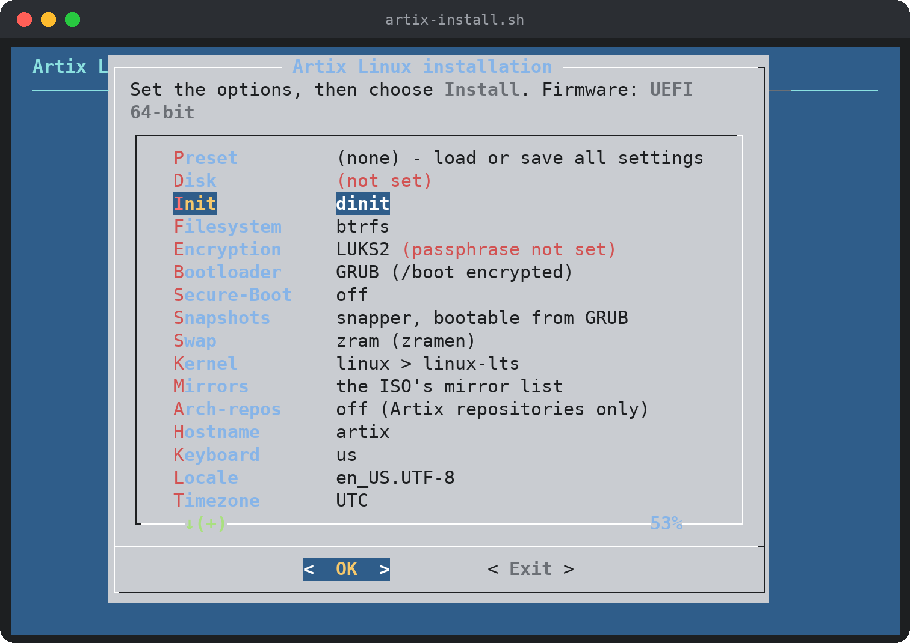
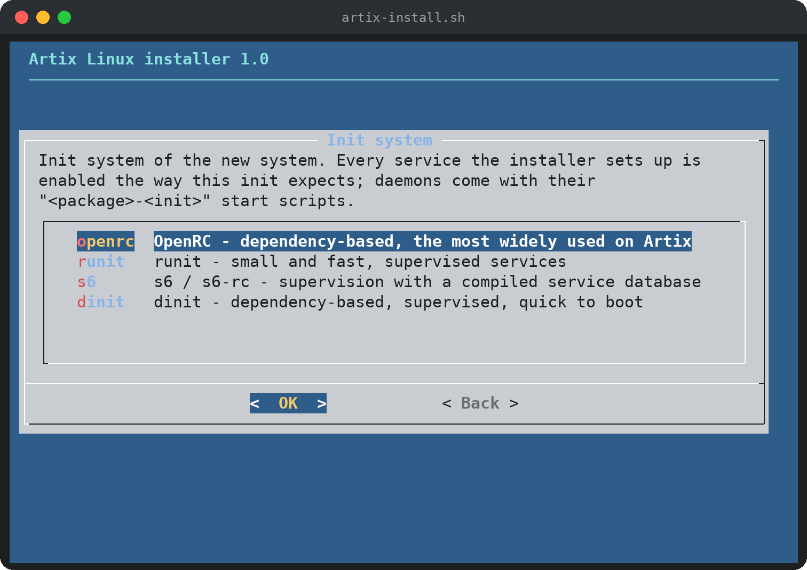

<div align="center">

# artix-install

**A menu-driven installer for [Artix Linux](https://artixlinux.org): Arch without systemd.**
One script, one disk, a full system on OpenRC, runit, s6 or dinit: encryption,
Secure Boot, btrfs or ZFS snapshots, your choice of boot loader, desktops or
window managers, and popular dotfiles.

[](LICENSE)




</div>

> [!WARNING]
> **The disk you select is erased completely.** There is no dual-boot mode.
> Back up anything you need first.

> [!NOTE]
> Version 1.0 is new. It is a port of
> [arch-install](https://github.com/aranmi-git/arch-install) and has been
> checked with a simulated install only, **not yet on real hardware**. Try it
> in a virtual machine first, and please report what you find.

## Quick start

Boot an official [Artix Linux ISO](https://artixlinux.org/download.php) (any
init), get online (`connmanctl` for Wi-Fi, or the installer's own Wi-Fi menu),
then as root:

```sh
curl -LO https://raw.githubusercontent.com/aranmi-git/artix-install/main/artix-install.sh
bash artix-install.sh
```

Set the options and choose **Install**. Only the disk, the root password, a
user and (if you encrypt) a passphrase are required. Or start from a preset:

```sh
bash artix-install.sh --preset kde-openrc
```

## Choose your init

<div align="center">

</div>

Artix ships a daemon's start scripts in a separate `<package>-<init>` package
(`networkmanager-openrc`, `sddm-dinit`, ...). The installer installs the right
ones and **reads the service names from each package's file list**, so nothing
is guessed, then enables them the way that init expects:

| Init | How a service is enabled |
|---|---|
| OpenRC | `rc-update add <service> default` |
| runit | symlink in `/etc/runit/runsvdir/default` |
| s6 | entry in `/etc/s6/adminsv/default/contents.d`, then `s6-db-reload` |
| dinit | symlink in `/etc/dinit.d/boot.d` |

Daemons Artix has no start script for (logiops, keyd, OpenLinkHub,
CoolerControl, grub-btrfsd, ...) get one written by the installer, for the
chosen init. What systemd does elsewhere is done here by: elogind (logins),
cronie (snapper timeline, weekly `fstrim`), chrony (time), zramen (zram),
and a small `artix-session` wrapper that gives window managers a D-Bus session
and PipeWire.

## What it can do

| | |
|---|---|
| **Init** | OpenRC, runit, s6, dinit |
| **Firmware** | UEFI (64-bit or 32-bit) and legacy BIOS, on GPT |
| **Filesystem** | ext4, btrfs with subvolumes, or **ZFS** (archzfs) |
| **Snapshots** | btrfs: snapper + snap-pac, hourly by cron, bootable from GRUB. ZFS: before every pacman transaction, bootable from ZFSBootMenu |
| **Encryption** | none, LUKS1 or LUKS2 (`encrypt` hook); ZFS sits on LUKS2 |
| **Secure Boot** | your own keys with sbctl (GRUB, rEFInd, EFISTUB) |
| **Boot loader** | GRUB, Limine, rEFInd, EFISTUB, SYSLINUX/EXTLINUX; ZFSBootMenu for ZFS |
| **Kernels** | linux, linux-lts, linux-zen, linux-hardened, in the boot order you choose |
| **Repositories** | Artix's, plus [lib32] for gaming; optionally Arch's [extra] and [multilib] |
| **Network** | NetworkManager, ConnMan, or dhcpcd + iwd |
| **Desktops** | KDE Plasma, GNOME, Xfce, COSMIC, Cinnamon, MATE, LXQt, Budgie, Enlightenment |
| **Window managers** | Hyprland, Sway, niri, river, labwc, Wayfire, i3, bspwm, dwm, awesome, Qtile, and more |
| **Login screen** | SDDM, GDM, LightDM, greetd + tuigreet, Ly (when Artix has its start script for your init) |
| **Dotfiles** | 21 presets: CachyOS (incl. Hyprland), EndeavourOS, Garuda, LARBS, gh0stzk, Chris Titus |
| **Also** | GPU drivers, apps, gaming, peripherals (Logitech, Corsair, Razer, ...), yay or paru, users with sudo levels, LARBS-style bootstrap, presets |

### Not offered on Artix

**systemd-boot** and **unified kernel images** need systemd's EFI stub, which
Artix does not ship. For the same reason ZFSBootMenu is installed as a kernel +
initramfs pair started by a UEFI boot entry instead of one EFI file.

## Arch repositories (optional)

The **Arch-repos** item adds Arch's [extra] (and [multilib] for 32-bit gaming)
through `artix-archlinux-support`, after Artix's own repositories, so Artix's
systemd-free builds always win. Off by default.

## ZFS

Choose **zfs** in the Filesystem item (64-bit UEFI). The pool `zroot` sits on
the root partition or on LUKS2; `zroot/ROOT/artix` holds `/` and `/boot`, and
`home`, `var/log` and `var/cache/pacman` are separate datasets mounted from
`/etc/fstab`, so no init needs ZFS start scripts. archzfs builds its modules
for Arch's kernels, so on Artix the module is compiled with `zfs-dkms`, on the
live ISO too: **use the newest Artix ISO**, whose kernel matches the
repository's `linux-headers`. The archzfs key's fingerprint is checked before
pacman trusts it. ZFSBootMenu 3.1.0 is built on the new system with the
`encrypt` hook (its release images cannot unlock LUKS); its initramfs on the
EFI partition is checked to hold no key.

## Presets

A preset holds every setting except the disk, passwords and users. Load one
with `--preset <name|file|https link>`; add `@<ID>` to refuse a changed one.

| Name | ID | What it installs |
|---|---|---|
| `minimal-runit` | `minimal-runit@ac5c96095f9c3190` | runit console server: LTS kernel, dhcpcd, SSH |
| `kde-openrc` | `kde-openrc@ee75d41d187bc135` | OpenRC, KDE Plasma, btrfs + snapshots, yay |
| `hyprland-dinit` | `hyprland-dinit@4a52f925de2b96b7` | dinit, Hyprland with CachyOS's settings, btrfs + snapshots |
| `i3-s6` | `i3-s6@1f6d8a729f4daa19` | s6, i3 with CachyOS's settings, btrfs + snapshots, paru |
| `gaming-kde-openrc` | `gaming-kde-openrc@1c94577411a0d1c1` | OpenRC, KDE, linux-zen, Steam/Wine/Lutris, Arch repositories on |
| `zfs-plasma-dinit` | `zfs-plasma-dinit@9ee039de3669dd1e` | dinit, KDE on ZFS, ZFSBootMenu, LTS kernel, ZFS snapshots |

All use LUKS2 encryption. A preset never holds passwords.

## After installing

```sh
sudo bash artix-install.sh --bootstrap   # add users, programs or dotfiles later
```

Wi-Fi joined on the live ISO is not carried over (its passphrase would have to
be stored in a file): connect again after the first boot with `nmtui`,
`connmanctl` or `iwctl`.

## Project status

Version 1.0. Lint-clean, and tested with a simulated install of every boot
loader on all four inits, ZFS, snapper, Secure Boot, the written services and
presets: about 540 automated checks. **Nothing has been installed on real
hardware or in a virtual machine yet.** See the [changelog](CHANGELOG.md).

## License

[GNU General Public License, version 2](LICENSE). No warranty. Dotfile
presets and AUR packages are downloaded at install time and stay under their
authors' licenses.
